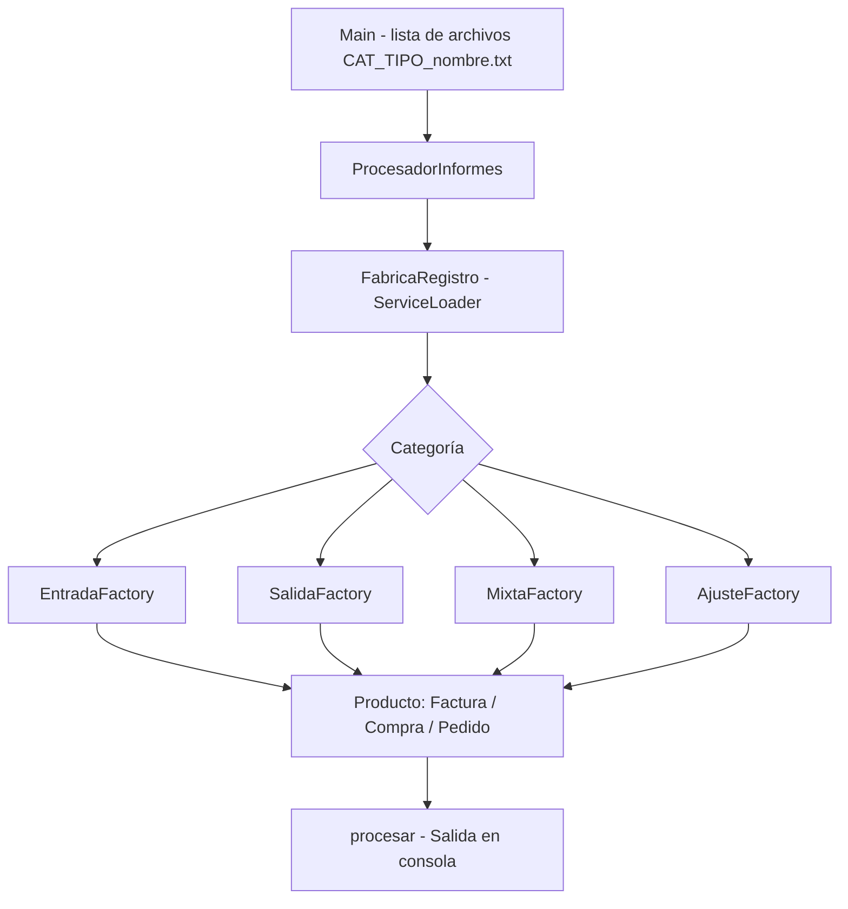

# Patrones de Creación en Java – Abstract Factory – Sistema para Procesar Informes

---

Este repositorio contiene el informe y el código Java desarrollados para la **Actividad No. 1: Patrones de creación** de la asignatura **Reutilización de Software** (UNIR). El sistema procesa informes clasificados por categoría y tipo usando el patrón **Abstract Factory**, y se evoluciona en etapas para medir el coste real de cambiar el diseño.

## Contenido del repositorio:

- `Desarrollo_Actividad1_Alejandro_De_Mendoza.pdf` → Informe de la actividad: análisis, diseño UML, implementación, evolución y desarrollo adicional.
- `Actividad1_Patrones_Creacion_codigo/` → Proyecto Java completo, con una carpeta por etapa:
  - `etapa1_base` → Sistema base: categorías ENTRADA y SALIDA, tipos FACTURA y COMPRA.
  - `etapa2_mixta` → Evolución 1: nueva categoría MIXTA.
  - `etapa3_pedido` → Evolución 2: nuevo tipo PEDIDO solo para ENTRADA.
  - `etapa4_servicios` → Categorías descubiertas con `ServiceLoader` y suite de 29 pruebas automáticas.
  - `etapa4b_ajuste` → Nueva categoría AJUSTE añadida sin modificar ninguna línea de Java existente.
  - `etapa5_registro` → Alternativa por registro por clave, con salida idéntica a la etapa 3.
  - `sinpatron` → Versiones sin patrón, para comparar.
  - `experimento` → Modelo de costes de evolución calibrado con mediciones reales y su gráfica.
  - `uml` → Diagramas UML (PNG y fuente Graphviz).

## Arquitectura

## Ejecución de los programas:

1. Tener instalado **JDK 8 o superior** (probado con JDK 21).
2. Entrar a la carpeta `Actividad1_Patrones_Creacion_codigo/`.
3. Ejecutar una etapa: `./compilar_ejecutar.sh etapa3_pedido`
4. Ejecutar las pruebas automáticas: `./probar.sh etapa4b_ajuste`
5. (Opcional) Reproducir el experimento de escalabilidad: `python3 experimento/escala.py`

## Evidencias incluidas en el informe

Cada etapa cuenta con:

- Diagrama **UML** de clases.
- Salida de la **ejecución** en consola.
- Explicación del diseño y del código.
- Medición del código modificado respecto a la etapa anterior.

El informe incluye además la suite de **29 pruebas** (con una prueba de arquitectura), el experimento de escalabilidad y la comparación con la alternativa por registro.

## Autor:

Este trabajo fue desarrollado en el marco de la asignatura **Reutilización de Software**.

- ***Alejandro De Mendoza*** – [Perfil GitHub](https://github.com/AlejoTechEngineer)

---
