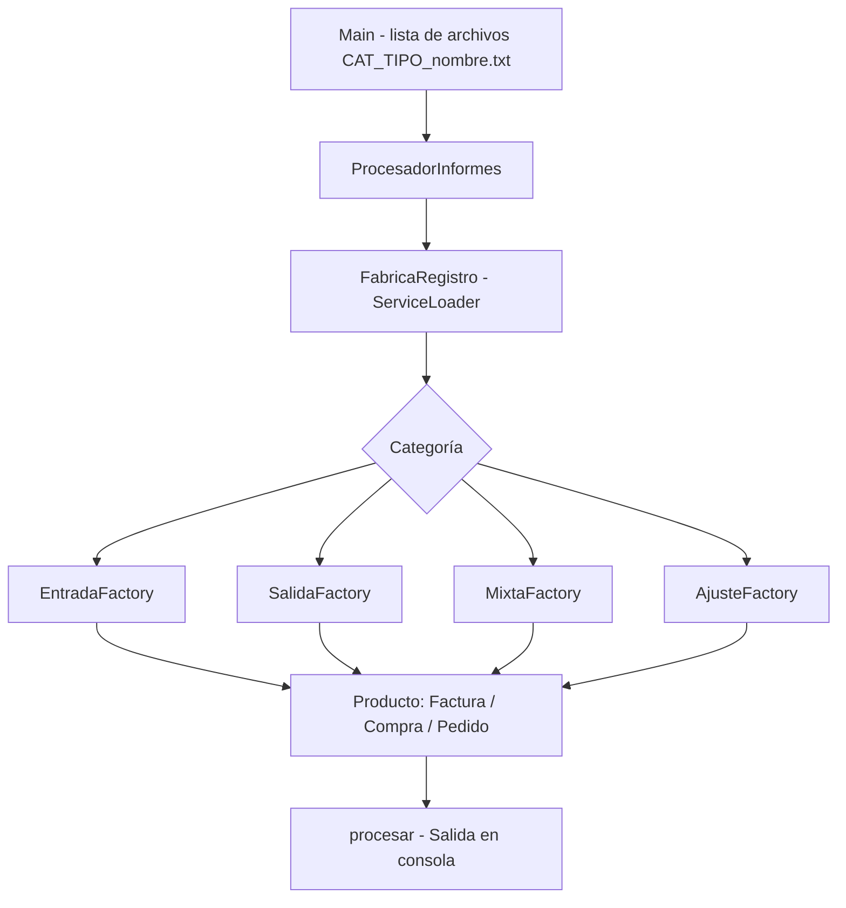
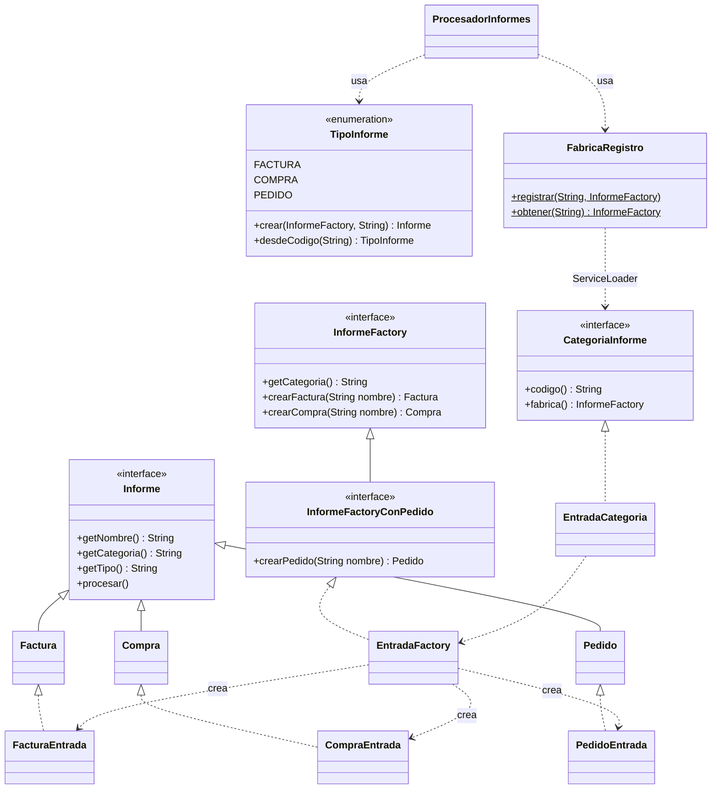
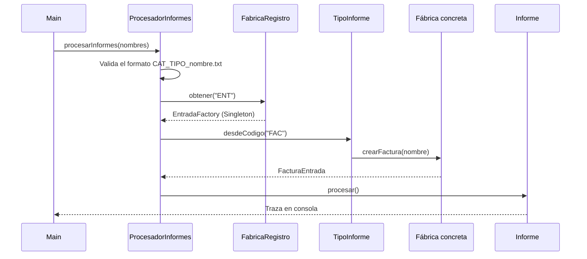

<div align="center">

# 🏭 Procesador de Informes – Patrón Abstract Factory en Java

### *Familias de informes, evolución medida en etapas, 29 pruebas automáticas y comparación con un diseño alternativo*

**Asignatura: Reutilización de Software · Fundación Universitaria Internacional de La Rioja (UNIR) · Actividad No. 1**

[]()
[]()
[]()
[]()
[]()
[]()
[]()

**[Contexto](#-contexto-y-alcance) • [Contenido](#-contenido-del-repositorio) • [Tecnologías](#-tecnologías-utilizadas) • [Arquitectura](#-arquitectura) • [Ejecución](#-ejecución) • [Pruebas](#-pruebas) • [Autor](#-autor)**


</div>

---

## 📋 Tabla de Contenidos

- [🎯 Contexto y Alcance](#-contexto-y-alcance)
- [📁 Contenido del Repositorio](#-contenido-del-repositorio)
- [🧰 Tecnologías Utilizadas](#-tecnologías-utilizadas)
- [🏗️ Arquitectura](#-arquitectura)
- [🧬 Diagrama de Clases](#-diagrama-de-clases)
- [🔁 Flujo de un Informe](#-flujo-de-un-informe)
- [🧩 Del Enunciado al Proyecto](#-del-enunciado-al-proyecto)
- [📈 Evolución por Etapas](#-evolución-por-etapas)
- [🚀 Ejecución](#-ejecución)
- [🧪 Pruebas](#-pruebas)
- [✅ Decisiones de Diseño](#-decisiones-de-diseño)
- [📝 Nota](#-nota)
- [👤 Autor](#-autor)

---

## 🎯 Contexto y Alcance

Este repositorio contiene el informe y el código Java de la **Actividad No. 1: Patrones de creación** de la asignatura **Reutilización de Software**. El sistema procesa informes cuyo nombre de archivo sigue el formato `CAT_TIPO_nombre.txt`: la **categoría** (ENTRADA, SALIDA, MIXTA, AJUSTE) es la **familia** y el **tipo** (FACTURA, COMPRA, PEDIDO) es el **producto** del patrón **Abstract Factory**.

El proyecto no se queda en la versión inicial: el sistema se **evoluciona en etapas independientes y compilables** y en cada una se mide cuánto código ya existente hubo que tocar. Así se comprueba con datos reales lo que el patrón promete (añadir familias es barato) y lo que cuesta (añadir productos es caro).

> **Problema:** procesar informes de varias categorías y tipos sin que el procesador dependa de las clases concretas.
> **Enfoque:** Abstract Factory, complementado con Singleton, una interfaz derivada para PEDIDO y `ServiceLoader`.
> **Alcance:** 6 etapas + versiones sin patrón → 29 pruebas automáticas → experimento de escalabilidad calibrado → comparación con un registro por clave.

### 🌟 ¿Qué demuestra este proyecto?

- 🏭 **Abstract Factory aplicado a un problema de dos dimensiones**: una fábrica concreta por categoría y una operación de creación por tipo.
- ➕ **Familia nueva sin tocar el cliente**: MIXTA se añade con 3 clases nuevas y 2 líneas en el registro de fábricas.
- ⚠️ **El punto débil, medido**: añadir el producto PEDIDO obliga a modificar código existente (17 líneas).
- 🔌 **Reutilización sin modificación**: con `ServiceLoader`, la categoría AJUSTE entra sin cambiar **ninguna línea de Java existente**.
- 🧪 **29 pruebas automáticas**, incluida una **prueba de arquitectura** que falla si el cliente vuelve a depender de clases concretas.
- ⚖️ **Comparación honesta**: una alternativa por registro por clave produce una salida idéntica a la etapa 3 con menos código.

---

## 📁 Contenido del Repositorio

<table align="center">
  <tr><th>Elemento</th><th>Descripción</th></tr>
  <tr><td colspan="2"><b>📂 raíz</b></td></tr>
  <tr><td><code>Desarrollo_Actividad1_Alejandro_De_Mendoza.pdf</code></td><td>📄 <b>Informe de la actividad</b>: análisis, diseño UML, implementación, evolución, desarrollo adicional y conclusiones</td></tr>
  <tr><td><code>README.md</code></td><td>📄 Este documento</td></tr>
  <tr><td><code>.gitignore</code></td><td>🚫 Mantiene en local los editables de Word, comprimidos y artefactos de compilación (<code>out/</code>, <code>*.class</code>)</td></tr>
  <tr><td colspan="2"><b>📂 Actividad1_Patrones_Creacion_codigo/</b></td></tr>
  <tr><td><code>compilar_ejecutar.sh</code></td><td>▶️ Compila y ejecuta una etapa (usa <code>javac</code> si está disponible)</td></tr>
  <tr><td><code>probar.sh</code></td><td>🧪 Compila una etapa y ejecuta la suite de pruebas <code>informes.app.PruebasSistema</code></td></tr>
  <tr><td><code>README.md</code></td><td>📄 Resumen de las carpetas y comandos de uso</td></tr>
  <tr><td><code>etapa1_base/</code></td><td>🧱 <b>Sistema base</b> (Ejercicio 2): categorías ENTRADA y SALIDA, tipos FACTURA y COMPRA · 15 archivos <code>.java</code></td></tr>
  <tr><td><code>etapa2_mixta/</code></td><td>➕ <b>Evolución 1</b> (Ejercicio 3): nueva categoría MIXTA · 18 archivos <code>.java</code></td></tr>
  <tr><td><code>etapa3_pedido/</code></td><td>➕ <b>Evolución 2</b> (Ejercicio 3): nuevo tipo PEDIDO solo en ENTRADA, mediante la interfaz derivada <code>InformeFactoryConPedido</code> · 21 archivos <code>.java</code></td></tr>
  <tr><td><code>etapa4_servicios/</code></td><td>🔌 Categorías descubiertas con <code>ServiceLoader</code> y suite de <b>29 pruebas</b> · 26 archivos <code>.java</code></td></tr>
  <tr><td><code>etapa4b_ajuste/</code></td><td>🧩 Nueva categoría AJUSTE añadida <b>sin modificar ninguna línea de Java existente</b> · 30 archivos <code>.java</code></td></tr>
  <tr><td><code>etapa5_registro/</code></td><td>⚖️ Alternativa sin Abstract Factory (registro por clave), con salida idéntica a la etapa 3</td></tr>
  <tr><td><code>sinpatron/</code></td><td>🧪 <code>ProcesadorSinPatronBase.java</code> y <code>ProcesadorSinPatronEvolucionado.java</code>: el mismo problema resuelto con condicionales, para comparar (Ejercicio 1)</td></tr>
  <tr><td><code>experimento/</code></td><td>📈 <code>escala.py</code> (modelo de costes de evolución calibrado con mediciones reales), <code>escalabilidad.png</code> y <code>salida_experimento.txt</code></td></tr>
  <tr><td><code>uml/</code></td><td>🧬 Diagramas UML de las tres etapas del enunciado: <code>uml_etapa1/2/3.png</code>, su fuente Graphviz (<code>.dot</code>) y el generador <code>uml.py</code></td></tr>
</table>

---

## 🧰 Tecnologías Utilizadas

<div align="center">


</div>

| Componente | Uso |
|:---|:---|
| **Java (JDK 8 o superior)** | Todo el código del sistema; solo usa características de Java 8. Probado con JDK 17 y 21 |
| **`java.util.ServiceLoader`** | Descubrimiento de categorías como *plugins* en las etapas 4 y 4b (`META-INF/services`) |
| **Bash** | `compilar_ejecutar.sh` y `probar.sh` (en Windows, con Git Bash o WSL) |
| **Python 3 + matplotlib** | Experimento de escalabilidad y su gráfica |
| **Graphviz** | Generación de los diagramas UML a partir de `uml.py` |
| **Mermaid** | Diagramas de este README |

---

## 🏗️ Arquitectura



`ProcesadorInformes` (el cliente) no conoce ninguna fábrica ni producto concreto: pide la fábrica a `FabricaRegistro` por el código de categoría y traduce el código de tipo con el enum `TipoInforme`. Desde la etapa 4, `FabricaRegistro` descubre las categorías con `ServiceLoader`, así que una categoría nueva solo necesita su paquete y una línea en `META-INF/services/informes.fabrica.CategoriaInforme`.

---

## 🧬 Diagrama de Clases

Núcleo del patrón en la etapa 4b (se omiten las categorías SALIDA, MIXTA y AJUSTE, que siguen el mismo esquema que ENTRADA):



Los diagramas UML completos de las etapas 1, 2 y 3 están en `Actividad1_Patrones_Creacion_codigo/uml/` y en el informe (Figuras 1, 3 y 5).

---

## 🔁 Flujo de un Informe



Si la categoría o el tipo no existen, o el nombre no tiene el formato esperado, la excepción se captura y se informa con una línea `[AVISO]` sin detener el procesamiento de los demás archivos.

---

## 🧩 Del Enunciado al Proyecto

| Requisito de la actividad | Cómo se resuelve |
|:---|:---|
| **Ejercicio 1:** ventajas e inconvenientes del patrón frente a una solución sin patrón | Capítulo 2 del informe y `sinpatron/` (versión base y evolucionada) |
| **Ejercicio 2:** diseño UML e implementación en Java | Figura 1 del informe, `uml/uml_etapa1.png` y `etapa1_base/` |
| **Ejercicio 3:** evolución con la categoría MIXTA | `etapa2_mixta/` y Figura 3 |
| **Ejercicio 3:** evolución con el tipo PEDIDO solo en ENTRADA | `etapa3_pedido/` y Figura 5 |
| **Análisis del impacto** de las evoluciones | Sección 4.3 del informe, con mediciones reales sobre el código |
| **Entrega del código** | Este repositorio, enlazado desde el informe |

---

## 📈 Evolución por Etapas

Medición real entre etapas (Tabla 5 del informe):

| Medida | Etapa 1 (base) | Etapa 2 (+ MIXTA) | Etapa 3 (+ PEDIDO) |
|:---|:---:|:---:|:---:|
| Archivos `.java` (incluye `Main`) | 15 | 18 | 21 |
| Líneas de código de producción (sin `Main`) | 261 | 306 | 348 |
| Archivos nuevos | — | 3 | 3 |
| Archivos de producción existentes modificados | — | 1 (`FabricaRegistro`, +2 líneas) | 2 (`EntradaFactory`, `TipoInforme`) |
| Cliente (`ProcesadorInformes`) e `InformeFactory` modificados | — | No | No |

| Etapa | Qué cambia | Código existente modificado |
|:---|:---|:---:|
| `etapa4_servicios` | Las categorías se registran solas con `ServiceLoader` | — |
| `etapa4b_ajuste` | Nueva categoría AJUSTE | **0 líneas de Java** (solo una línea en el descriptor de servicios) |
| `etapa5_registro` | Registro por clave, sin fábricas | Salida idéntica a la etapa 3, con 14 archivos y 211 líneas de producción |

<details>
<summary><b>📊 Ver el experimento de escalabilidad</b></summary>

`experimento/escala.py` modela cuántas líneas de código existente hay que modificar en tres escenarios, con cuatro diseños. Antes de extrapolar, el modelo se calibró contra el código real: los 6 puntos de calibración coinciden con la medición.

| Escenario (C = 5 categorías, T = 3 tipos) | Sin patrón | Abstract Factory | AF + ServiceLoader | Registro por clave |
|:---|:---:|:---:|:---:|:---:|
| Añadir una categoría | 10 | 2 | 0 | 4 |
| Añadir un tipo a todas las categorías | 10 | 24 | 24 | 5 |
| Añadir un tipo a una sola categoría | 2 | 17 | 17 | 1 |

Abstract Factory gana claramente cuando el cambio es añadir familias, y es el diseño más costoso cuando el cambio es añadir productos. La gráfica está en `experimento/escalabilidad.png`.

</details>

---

## 🚀 Ejecución

1. Tener instalado **JDK 8 o superior** (probado con JDK 17 y 21) y verificar con `java -version`.
2. Clonar el repositorio:
   ```bash
   git clone https://github.com/AlejoTechEngineer/abstract-factory-procesador-informes.git
   cd abstract-factory-procesador-informes/Actividad1_Patrones_Creacion_codigo
   ```
3. Ejecutar una etapa:
   ```bash
   ./compilar_ejecutar.sh etapa3_pedido
   ```
4. Ejecutar las pruebas automáticas:
   ```bash
   ./probar.sh etapa4b_ajuste
   ```
5. (Opcional) Reproducir el experimento de escalabilidad (requiere matplotlib):
   ```bash
   python3 experimento/escala.py
   ```

Sin Bash, cada etapa se compila y ejecuta a mano:

```bash
javac -encoding UTF-8 -d out $(find etapa3_pedido/src -name "*.java")
java -cp out informes.app.Main
```

| Acción | Comando |
|:---|:---|
| ▶️ Ejecutar cualquier etapa | `./compilar_ejecutar.sh <etapa>` |
| 🧪 Ejecutar la suite de pruebas | `./probar.sh etapa4_servicios` o `./probar.sh etapa4b_ajuste` |
| ⚖️ Comprobar la equivalencia de la alternativa | Comparar la salida de `etapa3_pedido` y `etapa5_registro` |

---

## 🧪 Pruebas

```bash
./probar.sh etapa4b_ajuste
# ...
# RESULTADO: 29 pruebas correctas, 0 fallos
```

`PruebasSistema` es una suite sin dependencias externas (no requiere JUnit) organizada en cinco grupos:

| Grupo | Comprobación | Riesgo que evita | Casos |
|:---:|:---|:---|:---:|
| P1 | Cada fábrica crea solo informes de su categoría y tipo correctos | Mezclar productos de familias distintas | 12 |
| P2 | Formatos y códigos inválidos lanzan la excepción esperada | Entradas corruptas que pasan sin aviso | 4 |
| P3 | PEDIDO se crea en ENTRADA y se rechaza en las demás | Que la interfaz derivada pierda su propósito | 4 |
| P4 | Las fábricas concretas son Singleton | Instancias duplicadas con estado inconsistente | 4 |
| P5 | **Arquitectura:** el cliente no importa categorías concretas, no usa `new` de productos ni compara cadenas con `equals()` | Que el acoplamiento regrese con una edición «cómoda» | 5 |

<details>
<summary><b>🔍 Ver la verificación de la prueba de arquitectura</b></summary>

Para comprobar que la prueba de arquitectura no es decorativa, se inyectó una violación: se añadió a `ProcesadorInformes` un `import informes.entrada.EntradaFactory`. La suite pasó de 29 correctas a **28 correctas y 1 fallo**, señalando exactamente esa regla.

| Paso | Qué se hace | Qué se observa |
|:---:|:---|:---|
| 1 | `./probar.sh etapa4b_ajuste` sobre el código entregado | 29 pruebas correctas, 0 fallos |
| 2 | Se añade a `ProcesadorInformes` el `import` de una fábrica concreta | — |
| 3 | `./probar.sh etapa4b_ajuste` | 28 correctas y 1 fallo, en la regla de arquitectura |

</details>

---

## ✅ Decisiones de Diseño

| Decisión | Dónde se aplica |
|:---|:---|
| 🏭 **Una fábrica concreta por categoría** (familia) y una operación de creación por tipo (producto) | `InformeFactory` y sus implementaciones |
| 1️⃣ **Fábricas concretas como Singleton** con inicialización inmediata, segura ante concurrencia | `EntradaFactory`, `SalidaFactory`, `MixtaFactory`, `AjusteFactory` |
| 🔤 **Traducción texto → tipo concentrada** en un enum, sin `switch` ni comparaciones de cadenas en el cliente | `TipoInforme` y `FabricaRegistro` |
| 🧩 **Segregación de interfaces** para PEDIDO: solo ENTRADA lo implementa y SALIDA y MIXTA no se tocan | `InformeFactoryConPedido` |
| 🔌 **Categorías como *plugins*** descubiertas en tiempo de ejecución | `CategoriaInforme`, `ServiceLoader`, `META-INF/services` |
| ♻️ **Código común en una clase base**: cada producto solo declara su categoría, su tipo y su acción | `InformeBase` |
| ⚠️ **Errores controlados**: una categoría o tipo desconocido se informa con `[AVISO]` sin detener el resto | `ProcesadorInformes` |
| ☕ **Compatibilidad con Java 8**: sin características de versiones posteriores | Todo el código |

---

## 📝 Nota

Este proyecto corresponde a una **actividad académica** y se elaboró con fines exclusivamente formativos. Los informes que procesa el sistema son nombres de archivo de ejemplo.

---

## 👤 Autor

<div align="center">

Este proyecto fue desarrollado en el marco de la asignatura **Reutilización de Software** de la **Fundación Universitaria Internacional de La Rioja (UNIR)** (Bogotá, Colombia), bajo la orientación del docente **Deivis Eduard Ramírez Martínez**.

| Autor | Perfil |
|:---:|:---:|
| ***Alejandro De Mendoza*** | [](https://github.com/AlejoTechEngineer) |

</div>

---

<div align="center">

### 🏭 *Añadir una familia es barato; añadir un producto, no*

**Reutilización de Software · Patrones de creación · Abstract Factory**

</div>
